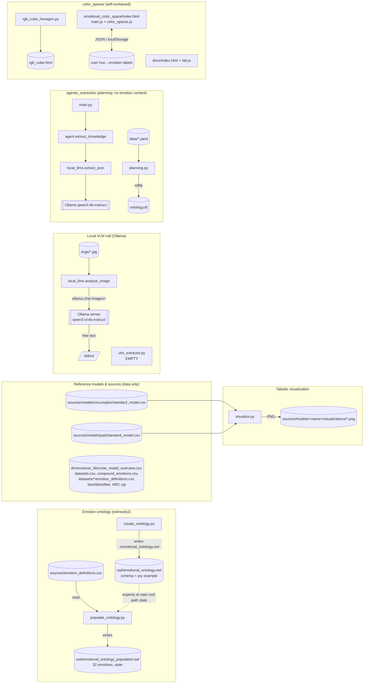

# PROJECT_OVERVIEW — Repository Reconnaissance

Repository: `dimensional_models_of_emotions` · branch `main` · HEAD `7000a9d` (2026-10-12) · 307 tracked files · reviewed 2026-11-10.

Conventions used in this document:

- **[V] Verified**: read directly from a file, or observed by running a command.
- **[I] Interpretation**: a reasonable reading of the evidence, not stated in the repository.
- **[U] Unknown**: the repository does not settle it.

Paths are relative to the repository root. `file:N` means line N.

---

## 1. Executive Summary

The repository is an **early-stage research workspace**, not an integrated system. It has four loosely related parts that do not call each other:

1. **Emotion ontology (OWL) and curated sources (core, emotion-related).** An OWL ontology (`owl/emotional_ontology.owl`) has classes named after conceptual-spaces terms: `ConceptualSpace`, `Domain`, `QualityDimension`, `ConvexRegion`, `PrototypicalInstance`, `Emotion ⊑ Concept`. It is built by `create_ontology.py` (owlready2). There is one hand-made example individual (`joy`) in a valence–arousal domain. `populate_ontology.py` adds `Emotion` individuals with textual `Definition`s and `KnowledgeRepository` sources taken from CSV. The committed populated file (`owl/emotional_ontology_populated.owl`) holds **32 emotions, the Plutchik set**, generated from an older CSV. The current CSV (`sources/emotion_definitions.csv`) has 91 rows. **No emotion has numeric coordinates in the ontology.**
2. **Reference psychological models as CSV, plus a plotting script.** `sources/models/circumplex/standard_model.csv` gives 28 emotion words with (valence, arousal) values. `sources/models/pad/standard_model.csv` gives 8 PAD octant labels with ±1 coordinates. `visualize.py` draws scatter plots of these tables. One committed PNG shows it has been run.
3. **Local LLM/VLM experiments via Ollama (minimal).** `local_llms.py` has a function `analyze_image` that sends an image and a free-text prompt to `qwen3-vl:4b-instruct` and returns free text. Nothing is parsed, stored, or linked to the ontology or the coordinates. `vlm_extractor.py` is an **empty file**. `agentic_extraction/` is a separate prototype for **robot task planning** (PDDL, RDF planning ontology, commonsense object properties such as color, shape, material). It has **no emotion content**.
4. **Color-space visualizations (`color_spaces/`, self-contained).** Browser and Python tools for RGB, HSL and HSV geometry. One app, `emotional_color_space/`, lets a user attach **their own emotion names to HSV hues**. Its README says these are "personal hypotheses … not established scientific correlations" (`color_spaces/emotional_color_space/README.md`).

Against the research abstract:

- **Ontology:** partially implemented. A schema exists, populated with definitions only.
- **VLM-based conceptual space generation:** not found beyond a single free-text VLM call.
- **User-defined models:** partially implemented, in a different sense. HSV hue labels exist. The CSV/visualize pipeline accepts any folder name.
- **Psychological alignment evaluation:** not found. Reference data exists but no comparison code.
- **Emotion detection evaluation:** not found. Dataset label lists exist but no dataset loaders or metrics.

---

## 2. Repository Structure

### 2.1 Languages, libraries, frameworks [V]

| Area | Language | Libraries (imported) | Declared in |
|---|---|---|---|
| Ontology build/populate | Python | `owlready2`, `pandas` | `requirements.txt` lists only `owlready2` |
| Visualization | Python | `matplotlib`, `pandas`, `scikit-learn` (PCA) | not declared |
| LLM/VLM calls | Python | `ollama` (Python client; Ollama server) | `README.md` (`pip install ollama`) |
| Planning prototype | Python | `rdflib`, `PyYAML`, `pydantic`, `ollama` | not declared |
| Color spaces | Python 3.11+, JavaScript | `numpy==2.4.6`, `plotly==7.1.0`; bundled `plotly.min.js` | `color_spaces/requirements.txt` |

There is no `pyproject.toml`, `setup.py`, lockfile, CI configuration, or package structure (no `__init__.py`). The scripts are standalone.

### 2.2 Directory tree (generated files, caches, vendored bundles and per-task duplicates omitted)

```
.
├── README.md                    # Title + Ollama install notes only
├── requirements.txt             # "owlready2"
├── .gitignore                   # .codex, .~*, .env
├── create_ontology.py           # Builds OWL schema with owlready2
├── populate_ontology.py         # Adds Emotion/Definition/KnowledgeRepository individuals from CSV
├── visualize.py                 # Plots sources/models/<name>/standard_model.csv
├── local_llms.py                # Ollama text chat + image analysis (qwen3-vl)
├── vlm_extractor.py             # EMPTY (0 bytes)
├── imgs/                        # angry.jpg, outraged.jpg (phone photos)
├── owl/
│   ├── emotional_ontology.owl            # Schema + hand-made "joy" example (243 lines)
│   └── emotional_ontology_populated.owl  # + 32 Plutchik emotions with definitions (1412 lines)
├── sources/
│   ├── emotion_definitions.csv           # 91 emotion labels × model/dataset tags × 5 dictionary definitions
│   ├── dimensional_model_overview.csv    # 4 dimensional models (Plutchik, PAD, circumplex, vector)
│   ├── discrete_model_overview.csv       # 3 discrete models (Ekman, Plutchik, Mikels)
│   ├── compound_emotions.csv             # 19 compound emotions (RAF-DB, Plutchik dyads)
│   ├── datasets.csv                      # EMOTIC, SentiWordNet, AffectNet + their dimensions
│   ├── datasets/{affectnet,emoset,emotic,goemotions}/emotion_definitions.csv  # label lists
│   ├── datasets/sentiwordnet/SentiWordNet_3.0.0.txt
│   ├── NRC-Emotion-Lexicon.zip           # third-party lexicon archive (not referenced by code)
│   └── models/
│       ├── circumplex/standard_model.csv  (+ visualizations/scatter_valence_arousal.png)
│       └── pad/standard_model.csv
├── agentic_extraction/          # Robot task-planning prototype (no emotion content)
│   ├── main.py, agent.py, local_llms.py, memory.py, schemas.py, tools.py
│   ├── planning.py              # rdflib planning ontology builder + SPARQL competency questions
│   ├── ontology.ttl             # planning ontology (RDFS)
│   ├── data/                    # actions.yaml, predicates.yaml, types.txt
│   ├── bringup/                 # PDDL tasks (13 + "real_world"), URDFs, results_ral*.csv
│   └── __pycache__/             # committed .pyc (Python 3.8)
└── color_spaces/                # Self-contained color-geometry lab
    ├── README.md, RGB_HSL.md, notes.md, requirements.txt
    ├── rgb_cube_hexagon.py      # Plotly RGB cube / HSL export
    ├── rgb-hsv.py               # EMPTY placeholder
    ├── test_rgb_cube_hexagon.py, test_portability.py, test_color_space.js, test_lab.js
    ├── docs/                    # RGB/HSL browser app (index.html, lab.js, color-space.js)
    └── emotional_color_space/   # HSV hexcone + user emotion labels (index.html, main.js, color_spaces.js, test.js)
```

### 2.3 Entry points [V]

| Entry point | Invocation | Effect |
|---|---|---|
| `create_ontology.py` | `python create_ontology.py` | Writes `emotional_ontology.owl` to the **current working directory** (`create_ontology.py:143`) |
| `populate_ontology.py` | `python populate_ontology.py` | Reads `<repo>/emotional_ontology.owl` and `sources/emotion_definitions.csv`, writes `<repo>/emotional_ontology_populated.owl` (`populate_ontology.py:6-9`) |
| `visualize.py` | `python visualize.py <model_name> [--base-dir .]` | Writes PNGs to `sources/models/<model_name>/visualizations/` (`visualize.py:129-168`) |
| `local_llms.py` | `python local_llms.py` | Pulls a model, then sends a hard-coded image path to `qwen3-vl:4b-instruct` (`local_llms.py:26-31`) |
| `agentic_extraction/main.py` | `python main.py` (from that dir) | Pulls `qwen3:4b-instruct`, extracts commonsense JSON for "apple" |
| `agentic_extraction/planning.py` | `python planning.py` | Builds the planning RDF graph, saves `ontology.ttl`, runs SPARQL CQs |
| `color_spaces/rgb_cube_hexagon.py` | `python rgb_cube_hexagon.py [--legacy] [--no-open] …` | Writes `rgb_cube.html` |
| `color_spaces/docs/index.html`, `color_spaces/emotional_color_space/index.html` | open in browser | Static interactive apps |

### 2.4 Installation / execution / testing documentation [V]

- `README.md`: install `zstd`, install Ollama, `ollama pull qwen3:4b`, `pip install ollama`. Nothing else.
- `color_spaces/README.md`: venv with Python 3.11, `pip install -r requirements.txt`, run commands, test commands (§9).
- No documentation covers the ontology scripts, `visualize.py`, the data CSVs, or the research design.

### 2.5 Path inconsistencies affecting execution [V]

- In commit `9d73768` ("small fixes"), `emotional_ontology.owl` and `emotional_ontology_populated.owl` moved into `owl/`. `populate_ontology.py:8-9` still points to `<repo>/emotional_ontology.owl`. Running it on the current layout would raise `FileNotFoundError` at `populate_ontology.py:43-47`, unless `create_ontology.py` is first run from the repo root. Even then, the output would be written to the root, not `owl/`.
- `local_llms.py:29` hard-codes `/home/user/repos/dimensional_models_of_emotions/imgs/outraged.jpg`. That path does not match this checkout.

---

## 3. Existing Conceptual Model

There is **no written definition** in the repository of what an "emotion", "concept", "dimension" or "conceptual space" means. Constructs are only visible through class names, column headers, and data. The table below separates the representations, which are **not connected to each other**.

### 3.1 Construct inventory

| Construct | Where it is represented | Representation | Explicit definition? |
|---|---|---|---|
| **Emotion** | OWL class `Emotion ⊑ Concept` (`create_ontology.py:20`; `owl/emotional_ontology.owl:126-128`) | Each emotion is an **OWL individual** of class `Emotion` (e.g. `#joy`, `#anger`). It is not a subclass. | No. The class has no `rdfs:comment`. |
| Emotion (lexical) | `sources/emotion_definitions.csv` column `emotion_label` | Capitalised English word. 91 rows; "Grief" appears twice. | Dictionary definitions per row (APA, SentiWordNet/WordNet, Cambridge, Oxford, Merriam-Webster) |
| Emotion (in model tables) | `sources/models/*/standard_model.csv` column `emotion` | Lower-case word, often adjectival ("angry", "sad", "at_ease") | No |
| Emotion (dataset label) | `sources/datasets/*/emotion_definitions.csv` | Dataset class name; definitions only for EMOTIC | EMOTIC: yes. Others: empty. |
| Compound emotion | `sources/compound_emotions.csv` | Name + component emotions + closest word + model/dataset | No |
| User-named emotion | `color_spaces/emotional_color_space` | Free-text name keyed by integer hue 0–359 | Explicitly "personal hypotheses" |
| **Concept** | OWL class `Concept` (`create_ontology.py:17`) | Superclass of `Emotion`. Has `hasRegion → ConvexRegion` and `hasPrototypicalInstance → PrototypicalInstance`. | No |
| **Conceptual space** | OWL class `ConceptualSpace` (`create_ontology.py:14`) | One individual `#emotion_space` (`owl/emotional_ontology.owl:174-180`), with context `affect_context`, similarity parameter `beta`, concept `joy`, domain `valence_arousal_domain` | No |
| **Domain** | OWL class `Domain` (`create_ontology.py:48`) | One individual `#valence_arousal_domain` | No |
| **Quality dimension / axis** | OWL class `QualityDimension` (`create_ontology.py:51`) | Individuals `#valence`, `#arousal` with `isCircular`, `hasMeasurementLevel`, `hasRange` (`owl/emotional_ontology.owl:228-241`) | No |
| Dimension (tabular) | Numeric CSV columns (`valence`, `arousal`; `pleasure`, `arousal`, `dominance`) | `visualize.py` treats every numeric column as a dimension, except names in `IGNORED_COLUMNS = {theta_deg, theta, angle, theta_degree}` (`visualize.py:11, 29-37`) | No |
| Dimension (overview) | `sources/dimensional_model_overview.csv` column `model_dimensions` | Comma-separated names; `range_min`/`range_max` given only for circumplex (−1, 1) | No |
| Dimension (datasets) | `sources/datasets.csv` column `dimensions` | e.g. EMOTIC "valence, arousal, dominance"; SentiWordNet "positive_score, negative_score" | No |
| Dimension (color) | HSV in `emotional_color_space` | Hue = "emotional direction", saturation = "emotional energy", value = "love / positive orientation" (`index.html` panel) | Stated as metaphors, not measurements |
| **Region** | `Region`, `ConvexRegion ⊑ Region`, `ContrastClass ⊑ Region` | One `#joy_region` linked to the domain and to both quality dimensions. It has **no geometry** (no bounds, center, or points). | No |
| **Prototype** | `PrototypicalInstance ⊑ Instance` | `#proto_joy`, linked only to a textual definition | No |
| **Point / coordinate** | OWL class `Point` (`create_ontology.py:29`); property `definedBy: Point → Definition` | **No `Point` individuals exist.** There is no property for a numeric coordinate value. | No |
| Coordinates (numeric) | `sources/models/circumplex/standard_model.csv`, `sources/models/pad/standard_model.csv` | Floats per emotion per dimension | Provenance not stated per file. See `dimensional_model_overview.csv` for model DOIs. |
| **Context** | `Context` class, `#affect_context` | No attributes | No |
| **Similarity sensitivity** | `SimSensParameter` ("Similarity sensitivity parameter", docstring `create_ontology.py:11`), `#beta` | No numeric value attached | Docstring only |
| **Action unit (FACS)** | `ActionUnit`, `hasActionUnit: Emotion → ActionUnit`, `#AU12` linked to `joy` | Name only | No |
| **Definition / source** | `Definition` (`hasValue: str`), `KnowledgeRepository`, `hasSource`, `orka:describedBy` | Text + source URL-derived individual | — |
| **Psychological model** | `sources/dimensional_model_overview.csv`, `sources/discrete_model_overview.csv`; `models` column in `emotion_definitions.csv` | Rows with label, DOI, dimension names. **Not represented in the ontology.** | No |
| Embeddings | — | **Not found.** No vector embeddings anywhere. | — |
| Model predictions | `local_llms.analyze_image` return value | Free-text string, printed, not stored | — |

### 3.2 Values, ranges, scales [V] with interpretations [I]

- **Ontology ranges are strings**, e.g. `hasRange "min=-1.0,max=1.0"` for valence and `"min=0.0,max=1.0"` for arousal (`owl/emotional_ontology.owl:232, 239`). Nothing parses or enforces them.
- **Range conflict (documented, not resolved):** the ontology gives arousal the range [0, 1]. `sources/models/circumplex/standard_model.csv` has arousal values from −1 to 1 (e.g. `sleepy,0.03,-1`). `dimensional_model_overview.csv` gives circumplex `range_min=-1, range_max=1`.
- **Circumplex coordinates lie close to the unit circle.** Vector norms range from 0.877 to 1.015 across all 28 rows (computed during this review). [I] This suggests positions were derived from angles, as in Russell's circular ordering, rather than independent ratings. `visualize.py` ignoring `theta`/`angle` columns is consistent with an earlier angle column. [U] Origin of the values is not documented.
- **PAD table** contains only the 8 octant corners with values in {−1, 1} (`sources/models/pad/standard_model.csv`). [I] These match Mehrabian's temperament octant labels (exuberant, dependent, relaxed, docile, bored, disdainful, anxious, hostile). They are not graded coordinates for individual emotions.
- `hasMeasurementLevel` accepts strings. `VALID_MEASUREMENT_LEVELS = {"nominal","ratio","interval","ordinal","categorical"}` (`create_ontology.py:139`) is a plain Python set. It is **not serialized** into the OWL and not checked anywhere.
- `isCircular` (boolean) is false for both valence and arousal. No circular dimension (e.g. hue, or circumplex angle) is modelled in the ontology.

### 3.3 Relationships between concepts

- **In OWL:** `ConceptualSpace —hasConcept→ Concept`, `Concept —hasRegion→ ConvexRegion —correspondsTo→ Domain`, `ConvexRegion —hasQualityDimension→ QualityDimension`, `ConceptualSpace —hasDomain→ Domain`. There are **no emotion-to-emotion relations** (no opposition, intensity, composition, or similarity).
- **In CSV:** `compound_emotions.csv` encodes compositions (e.g. Love = Joy + Trust, "Plutchik"). The `models` and `datasets` columns of `emotion_definitions.csv` encode which emotion words belong to which model or dataset. None of this is loaded into the ontology. `populate_ontology.py` reads neither column.

### 3.4 Explicit vs implicit

- **Explicit:** OWL class and property declarations with domain and range. Dictionary definitions. The color app's disclaimer.
- **Implicit [I]:**
  - The vocabulary (quality dimension, domain, convex region, prototype, contrast class, similarity sensitivity) closely follows Gärdenfors' conceptual-spaces theory. The repository never cites it.
  - "Emotion word ≡ emotion concept" is assumed throughout.
  - Tables assume one point per emotion word per model.

### 3.5 Lexical misalignment across sources [V]

Emotions are matched only by string, and the forms differ between files. The circumplex table uses `angry, annoyed, bored, delighted, frustrated, sad, serene, afraid`. The rows of `emotion_definitions.csv` tagged `circumplex` use `Anger, Annoyance, Boredom, Delight, Frustration, Sadness, Serenity, Fear`. Eight words differ in each direction (computed during this review). No mapping table exists.

---

## 4. Ontology and Knowledge Representation

### 4.1 Emotion ontology [V]

- **IRI:** `http://example.org/conceptual-space-emotion.owl` (placeholder domain).
- **Format:** RDF/XML produced by owlready2.
- **Classes (16):** `Context, SimSensParameter, ConceptualSpace, Concept, Emotion ⊑ Concept, Instance, PrototypicalInstance ⊑ Instance, Point, Definition, KnowledgeRepository, Region, ContrastClass ⊑ Region, ConvexRegion ⊑ Region, Domain, QualityDimension, ActionUnit` (`create_ontology.py:7-55`).
- **Object properties (14):** `hasContext, hasSimParam, hasContrastClass, hasInstance, hasConcept, hasDomain, hasRegion, hasPrototypicalInstance, definedBy, hasDefinition, hasSource, orka:describedBy, hasActionUnit, correspondsTo, hasQualityDimension` (`create_ontology.py:58-117`). `describedBy` is declared in the namespace `https://w3id.org/def/orka#` (`create_ontology.py:103`).
- **Data properties (4):** `hasValue (Definition→str)`, `isCircular (functional, bool)`, `hasMeasurementLevel (functional, str)`, `hasRange (functional, str)` (`create_ontology.py:120-134`).
- **Axioms:** only `rdfs:subClassOf`, `rdfs:domain`, `rdfs:range`, and `owl:FunctionalProperty`. There are no disjointness axioms, cardinality restrictions, inverse properties, or equivalences.
- **Imports:** none. ORKA is used only as a namespace prefix. There is no `owl:imports`. [U] Whether alignment with the ORKA ontology is intended is not stated.
- **Individuals in `owl/emotional_ontology.owl`** (lines 174-241): `emotion_space, affect_context, beta, valence_arousal_domain, joy, joy_region, proto_joy, joy_definition ("A pleasant, high-valence affective state."), wikidata_repo, AU12, valence, arousal`.

### 4.2 Conflict between script and serialized ontology [V]

- `create_ontology.py:115-117` declares `hasQualityDimension` with **domain `Domain`**. Both OWL files declare its **domain as `ConvexRegion`** (`owl/emotional_ontology.owl:82-85`), and `#joy_region` uses it that way.
- `create_ontology.py` creates **no individuals**. The 12 example individuals in `owl/emotional_ontology.owl` must therefore have been added outside the script. [U] How (e.g. Protégé or another script) is unknown.
- So running `create_ontology.py` today would **not** reproduce `owl/emotional_ontology.owl`.

### 4.3 Population [V]

`populate_ontology.py`:

- Reads the CSV with pandas.
- Loads the base ontology.
- For each row, gets or creates an `Emotion` individual named `safe_name(emotion_label)` (`:17-25, 76-77`). It sets `rdfs:label` and adds `synset: <id>` as an `rdfs:comment` (`:81-86`).
- For three of the five definition columns (`apa`, `sentiwordnet`, `cambridge`; `SOURCE_COLUMNS` at `:11-15`), it creates a `Definition` individual with `hasValue` text. If the source cell is present, it creates a `KnowledgeRepository` named from the source URL and links it with `definition.hasSource` and `emotion.describedBy` (`:88-124`).
- **Definitions are not linked to their Emotion by any object property.** The code comment says so explicitly (`:105-108`). The link exists only through duplicated `rdfs:comment` strings (`:126-131`) and through the shared source.
- Columns `oxford_*`, `merriam-webster_*`, `models`, and `datasets` are ignored.
- **No coordinates, dimensions or regions are populated.**

### 4.4 State of the populated file [V]

- `owl/emotional_ontology_populated.owl` was committed in the initial commit `6c481b0`. At that time the script read `sources.csv` (32 rows).
- It contains 32 `Emotion`, 90 `Definition` and 56 `KnowledgeRepository` individuals. The 32 emotions are `acceptance … vigilance`. [I] These are the Plutchik wheel's 24 emotions plus 8 dyads.
- The current `sources/emotion_definitions.csv` (91 rows) has 58 labels that are **not** in the populated file (e.g. `happy, calm, exuberant, neutral`). **The populated ontology is stale relative to the CSV.**

### 4.5 Reasoning, validation, persistence

- **Reasoning:** none. No reasoner call (`sync_reasoner`, HermiT or Pellet) appears anywhere.
- **Validation:** none (no SHACL, no consistency checks). `valid_cell` (`populate_ontology.py:27-31`) is only CSV-cell filtering.
- **Persistence:** RDF/XML files on disk via `onto.save(..., format="rdfxml")`. No triple store.
- **Connection to the rest of the system:** **none.** No other module reads the OWL files. `visualize.py` reads CSV only. `local_llms.py` uses neither.

### 4.6 Planning ontology (separate) [V]

`agentic_extraction/ontology.ttl` (RDFS, namespace `http://example.org/planning#`) is built by `agentic_extraction/planning.py` with rdflib (`OntologyBuilder`, `PlanningOntologyBuilder`, `PlanningOntologyPopulator`, `KnowledgeInterface`). It models PDDL planning entities (`PlanningAction`, `PlanningPredicate`, `Capability`, …) and is queried with SPARQL "competency questions" (`PlanningCompetencyQuestion`, `planning.py:163`). It has **no emotion concepts**. [I] It may serve as a methodological template, such as the competency-question pattern. [U] Its intended relationship to this project is unknown.

---

## 5. Models and Generation Pipeline

### 5.1 Supported models [V]

| Model tag | Where | Modality actually used |
|---|---|---|
| `qwen3-vl:4b-instruct` | `local_llms.py:4, 21` | **Image + text** (`images=[path]` in `ollama.chat`). This is the only VLM usage. |
| `qwen3:4b` | `local_llms.py:6` default of `load_llm`; `agentic_extraction/agent.py:6` | Text only |
| `qwen3:4b-instruct` | `agentic_extraction/main.py:7`, `agent.py:16` | Text only, JSON-schema constrained |

- All inference goes through a **local Ollama server**. No HuggingFace, OpenAI, or other back-end exists.
- `ollama list` on this machine shows only `qwen3:4b`. `qwen3-vl:4b-instruct` is not pulled locally.
- **Quirk:** in `local_llms.py`, `load_llm(model)` pulls whatever model it is given. `analyze_image` **hard-codes** `qwen3-vl:4b-instruct` and accepts no model parameter (`:18-23`).

### 5.2 Prompting and structured output [V]

- **Emotion-related prompting:** a single literal prompt, `"What emotion can you detect?"` (`local_llms.py:31`), applied to `imgs/outraged.jpg`. Default system prompt for text chat: `"You are a helpful assistant."`. There are no prompt templates, no list of allowed labels, no dimensional rating prompts, and no few-shot examples.
- **Structured output** exists **only in `agentic_extraction`**. `extract_json` passes `format=schema.model_json_schema()` with `temperature=0` (`agentic_extraction/local_llms.py:10-16`), using the pydantic schema `CommonsenseKnowledge{color, shape, material, function: List[str]}` (`schemas.py`). It is applied to the entity "apple". This is object commonsense, not emotion.
- **Tool calling** (`agent.run_agent`): one round of tool calls, with a single tool `get_time`.

### 5.3 Extraction and conceptual-space construction

- **Extracting emotional information from models:** free-text answer only. It is printed and not parsed or stored.
- **Constructing or populating conceptual spaces from model output: not found.** `vlm_extractor.py` is 0 bytes. [I] Its name suggests this is where VLM extraction was planned.
- **Probabilities, logits, numeric estimates, uncertainty: not found.** No `logprobs`, sampling options, or repeated sampling for emotions. (`temperature=0` appears only in the commonsense extractor.)
- **Model configuration mechanism:** hard-coded string constants and function defaults. No config files and no CLI flags for models.

### 5.4 Data flow (as implemented)

```
imgs/outraged.jpg ──► local_llms.analyze_image(path, prompt) ──► ollama.chat(qwen3-vl:4b-instruct, images=[path])
                                                                     │
                                                                     ▼
                                                         response.message.content (str) ──► print()   [not stored]
```

---

## 6. Evaluation Framework

### 6.1 Reference material present (data only) [V]

| Material | File | Content | Used by code? |
|---|---|---|---|
| Circumplex reference coordinates | `sources/models/circumplex/standard_model.csv` | 28 words × (valence, arousal) | Only `visualize.py` (plotting) |
| PAD reference coordinates | `sources/models/pad/standard_model.csv` | 8 octants × (P, A, D) ∈ {±1} | Only `visualize.py` (no PNG committed) |
| Dimensional model registry | `sources/dimensional_model_overview.csv` | 4 models, DOIs, dimension names; column `ground_truth = yes` only for circumplex | No |
| Discrete model registry | `sources/discrete_model_overview.csv` | Ekman (spelled "eckman"), Plutchik (labels empty), Mikels (8 labels) | No |
| Dataset registry | `sources/datasets.csv` | EMOTIC (VAD), SentiWordNet (pos/neg scores), AffectNet (VA) | No |
| Dataset label sets | `sources/datasets/{affectnet,emoset,emotic,goemotions}/emotion_definitions.csv` | 8 / 8 / 26 / 26 labels. Definitions only for EMOTIC. | No |
| Lexicons | `sources/datasets/sentiwordnet/SentiWordNet_3.0.0.txt`, `sources/NRC-Emotion-Lexicon.zip` | Full third-party lexicons | No |
| Example images | `imgs/angry.jpg`, `imgs/outraged.jpg` | Two photos; no annotation file | Only `local_llms.py` `__main__` |

- **Ground-truth annotations:** the only thing labelled ground truth is the `ground_truth = yes` flag on the circumplex model. [I] This suggests the circumplex table is the intended psychological reference. No image or text dataset with emotion annotations is present. The datasets are referenced by name and DOI only.
- **`compound_emotions.csv`** mentions RAF-DB, which is **not** in `datasets.csv`.

### 6.2 Evaluation procedures [V]

- **Psychological alignment** (e.g. correlation, Procrustes, rank agreement between generated and reference coordinates): **not found**.
- **Emotion detection accuracy:** **not found** (no dataset loaders, train/test splits, classifiers, or metrics).
- **Repeated runs, seeds, statistics:** **not found** for emotion work.
- **Results storage and visualization:** only the committed `sources/models/circumplex/visualizations/scatter_valence_arousal.png`, which is the output of `visualize.plot_2d`.

### 6.3 Evaluation in the unrelated planning prototype [V]

`agentic_extraction/bringup/results_ral.csv` and `results_ral_no_filtering.csv` contain per-task metrics (`md, mp, mplan, vocab_p, vocab_r, vocab_f1, vocab_f1_relaxed, goal_exact, goal_jaccard, plan_length`) for 12 PDDL tasks. These evaluate planning-domain generation. The code that produced them is **not in this repository**. [U]

---

## 7. Interfaces and Visualization

| Capability | Exists? | Where / how |
|---|---|---|
| Define or edit emotional models | **Partly.** Hand-edit CSV/OWL files. The HSV app lets a user name hues. | `sources/models/<name>/standard_model.csv`; `color_spaces/emotional_color_space` label form |
| Generate conceptual spaces | **No** (no generation from models) | — |
| Visualize dimensional spaces | **Yes** (static PNGs from CSV) | `visualize.py`: 1D histogram + strip; 2D scatter with axes at 0; 3D scatter; >3 dims → scatter matrix + PCA (`visualize.py:49-126`). Any folder under `sources/models/` with a `standard_model.csv` works. |
| Visualize color spaces | **Yes** (interactive, browser) | `color_spaces/docs/` (RGB cube / HSL), `color_spaces/emotional_color_space/` (HSV hexcone) |
| Compare models | **No.** There is no overlay or side-by-side comparison. | — |
| Inspect individual concepts | **Only via OWL tools** (e.g. Protégé) or by reading CSVs. The HSV app shows the label for the selected hue. | — |
| Export / import | **OWL** RDF/XML writes. **HSV app:** JSON export/import of `{"version":1,"labels":{"<hue>":"name"}}` with validation; localStorage key `emotional-color-space.labels.v1` (`color_spaces/emotional_color_space/main.js:5, 78-91`; `color_spaces.js:124-140`) | — |

**What a user can do today:**

1. Plot a tabular reference model with `python visualize.py circumplex` (or `pad`).
2. Open the HSV hexcone in a browser, attach personal emotion names to hues, and export or import them as JSON.
3. Regenerate the ontology schema, and, after fixing paths locally, the populated ontology.
4. Ask a local VLM, in free text, what emotion it sees in an image.

---

## 8. Architecture and Data Flows

### 8.1 Component diagram (actual components only; no edges exist between the clusters)



Note: `REG`, `POP`, `VE`, and the `Agentic` and `Color` clusters have no consumers in the emotion pipeline. The diagram does not draw edges that do not exist.

### 8.2 One complete implemented execution path: `python visualize.py circumplex`

This is the only emotion-related path that runs end to end on the current layout and has committed output.

```mermaid
sequenceDiagram
  participant U as User
  participant M as visualize.main
  participant FS as sources/models/circumplex/
  participant P as plot_2d
  U->>M: python visualize.py circumplex [--base-dir .]
  M->>M: infer_csv_path() → sources/models/circumplex/standard_model.csv
  M->>FS: pd.read_csv(standard_model.csv)
  M->>M: find_label_column() → "emotion"
  M->>M: find_dimension_columns() → ["valence","arousal"] (theta-like cols ignored)
  M->>FS: mkdir visualizations/
  M->>P: len(dims)==2
  P->>P: scatter + axhline/axvline(0) + annotate labels; equal aspect if all in [-1.1,1.1]
  P->>FS: savefig(scatter_valence_arousal.png, dpi=200)
```

The ontology population path (`populate_ontology.py`) is implemented. It cannot run on the current layout without the base OWL at the repository root (§2.5).

---

## 9. Tests and Reproducibility

### 9.1 Test inventory [V]

| Test file | Covers | Runner |
|---|---|---|
| `color_spaces/test_rgb_cube_hexagon.py` | RGB cube section geometry, hexagon vertices, figure serialization, offline export (13 `test_*` methods) | `unittest` |
| `color_spaces/test_portability.py` | Static assets are local; both export modes run from an isolated temp copy | `unittest` |
| `color_spaces/test_color_space.js`, `color_spaces/test_lab.js` | RGB/HSL JS geometry and controller (DOM/Plotly stubs) | `node` |
| `color_spaces/emotional_color_space/test.js` | HSV→RGB, hexcone geometry, label JSON validation, controller | `node` |
| — | **No tests** for `create_ontology.py`, `populate_ontology.py`, `visualize.py`, `local_llms.py`, or `agentic_extraction/` | — |

### 9.2 Commands executed in this review and outcomes

No packages were installed, no models were pulled, and no repository file other than this report was written. Bytecode writing was disabled for the test run.

| # | Command | Outcome |
|---|---|---|
| 1 | `python3 --version` | `Python 3.12.3` (no `python3.11`; no `color_spaces/.venv`) |
| 2 | `which node` | not found. **JS tests not run.** |
| 3 | import probe for `owlready2, pandas, matplotlib, sklearn, ollama, numpy, plotly, rdflib, yaml, pydantic` | Present: `matplotlib 3.6.3`, `numpy 1.26.4`, `yaml 6.0.1`. Missing: all others. So `create_ontology.py`, `populate_ontology.py`, `visualize.py` and `local_llms.py` **cannot run** in this environment. |
| 4 | `cd color_spaces && PYTHONDONTWRITEBYTECODE=1 python3 -m unittest discover -s . -v` | 3 run, 3 errors. `test_static_assets_are_local` **ok**. `test_exports_from_extracted_directory` (legacy=False / True): **ERROR**, subprocess exit 1. `test_rgb_cube_hexagon`: **ERROR** `ModuleNotFoundError: No module named 'plotly'`. All errors come from the missing `plotly` dependency, not test logic. |
| 5 | `ast.parse` over every tracked `*.py` | All 16 files parse (including the two empty files) |
| 6 | `ollama list` | Only `qwen3:4b` present locally |
| 7 | `git status --short --ignored` | Clean before writing this report |

Other read-only evidence came from `git log --stat`, `git show <rev>:<path>`, `grep`, `file`, `unzip -l`, and short Python scripts that parse CSV and OWL text (norms, label set differences, individual counts).

### 9.3 Reproducibility controls [V]

- **Dependencies:** `requirements.txt` declares only `owlready2`. Missing: `pandas`, `matplotlib`, `scikit-learn`, `ollama`, `rdflib`, `pyyaml`, `pydantic`. Only `color_spaces/requirements.txt` pins versions.
- **Seeds, temperature, run IDs, logging:** none for emotion work. `temperature=0` appears only in `agentic_extraction/local_llms.py:15`.
- **Model versions:** Ollama tags only (`qwen3-vl:4b-instruct`), with no digest pinning.
- **External dependencies for experiments:** an Ollama server and the `qwen3-vl:4b-instruct` model. Datasets (EMOTIC, AffectNet, EmoSet, GoEmotions, RAF-DB) are not included; only their label lists are.
- **Committed artifacts:** `__pycache__/*.cpython-38.pyc` in `agentic_extraction/` (Python 3.8, while this machine has 3.12). The `.gitignore` does not exclude `__pycache__` at the root level.

### 9.4 Known limitations stated in documentation [V]

`color_spaces/README.md` and `color_spaces/emotional_color_space/notes.md` state:

- JS controller tests use stubs.
- Real WebGL rendering and browser behaviour are unverified.
- Headless Chrome failed in an earlier sandbox.

No limitations are documented for the emotion components.

---

## 10. Research Objective Traceability Matrix

| Research objective | Existing implementation | Evidence | Status | Unknowns |
|---|---|---|---|---|
| **Ontology** representing emotions, their conceptualizations, and numerical axes | OWL schema with `Emotion ⊑ Concept`, `ConceptualSpace`, `Domain`, `QualityDimension` (with measurement level, range string, circularity), `ConvexRegion`, `PrototypicalInstance`, `Definition`, `KnowledgeRepository`. One worked example (`joy` in a valence–arousal domain). 32 emotions with dictionary definitions. | `create_ontology.py:7-139`; `owl/emotional_ontology.owl:174-241`; `owl/emotional_ontology_populated.owl`; `populate_ontology.py` | **Partially implemented** | How emotion coordinates or points would be encoded (no numeric coordinate property exists). Whether psychological models should be ontology entities. Intended semantics of `Point`, `ContrastClass`, `Context`, `SimSensParameter`. The script/OWL conflict on `hasQualityDimension` (§4.2). ORKA alignment. |
| **Conceptual space generation** with VLMs | One free-text VLM call (`qwen3-vl:4b-instruct`, image + prompt). No parsing, no coordinates, no storage. `vlm_extractor.py` is empty. | `local_llms.py:18-31`; `vlm_extractor.py` (0 bytes) | **Not found** (only a precursor VLM call exists) | Whether generation is meant to be image-conditioned, word-conditioned, or both. Output form: ratings, pairwise similarities, logits, or embeddings. |
| **User-defined models** (concepts and models chosen by the user) | (a) `visualize.py` plots any `sources/models/<name>/standard_model.csv`. (b) The HSV app stores user-chosen emotion names per hue. Neither connects to the ontology or to any LLM/VLM. | `visualize.py:14-16, 129-168`; `color_spaces/emotional_color_space/main.js:72-91`, `color_spaces.js:124-140` | **Partially implemented** | Whether "user-defined" means user-defined dimensions, user-defined concept lists, user-chosen VLMs, or all three. Whether the HSV metaphor is part of the research scope. |
| **Psychological alignment evaluation** | Reference coordinate tables (circumplex flagged `ground_truth=yes`; PAD octants) and model registries with DOIs. No comparison code or metrics. | `sources/models/*/standard_model.csv`; `sources/dimensional_model_overview.csv` | **Not found** (reference data only) | Provenance of the circumplex values (they appear angle-derived, §3.2). Which reference values count as "established". Label mapping between word forms (§3.5). Which metric to use. |
| **Emotion detection evaluation** | Label lists for AffectNet, EmoSet, EMOTIC, GoEmotions. Dataset registry. Two unannotated example images. No loaders, classifiers, or metrics. | `sources/datasets/*/emotion_definitions.csv`; `sources/datasets.csv`; `imgs/` | **Not found** | Which datasets and modality (image vs text: GoEmotions and SentiWordNet are text). How extracted spaces would feed a detector. Baseline definition. |

---

## 11. Conceptual Ambiguities and Open Questions

These are listed for the researcher to decide. Highest-impact questions on the conceptual model come first. None is resolved here.

1. **Is an emotion an individual or a class?** Emotions are modelled as individuals of `Emotion`, which is a subclass of `Concept`. In conceptual-spaces terms a concept is a region, and its instances are points. Is `joy` a concept with instances (e.g. joyful images or experiences), or an instance of the class Emotion? This affects what `hasInstance`, `PrototypicalInstance` and `Point` refer to.
2. **What carries a coordinate?** `Point` exists but has no individuals and no numeric property, and `definedBy: Point → Definition` links points to *text*. Should a coordinate belong to an emotion concept, a prototype, a stimulus instance (image), or a (model, emotion) pair?
3. **Emotion word vs emotion concept vs dataset label.** The same emotion appears as "Anger" (definitions), "angry" (circumplex), "anger" (GoEmotions) and "Angrily surprised" (compounds). Are these one concept with lexical variants, or distinct concepts? Is the mapping manual or derived (e.g. through the WordNet synset IDs already in the CSV)?
4. **Arousal range: [0, 1] or [−1, 1]?** The ontology says [0, 1]. The circumplex CSV and overview say [−1, 1]. Are ranges a property of the dimension, of the model, or of the measurement instrument?
5. **Status of the circumplex reference values.** They lie on or near the unit circle. Are they intended as angular placements (circular ordering) or as independent valence/arousal ratings? This decides whether `isCircular` or an angle dimension is needed, and what "alignment" can mean.
6. **Is "dimension" the same as "quality dimension" and as "axis"?** `QualityDimension` carries measurement-level metadata. The CSV columns carry none. SentiWordNet uses `positive_score, negative_score`, which may or may not be treated as a valence axis. Plutchik is listed as a *dimensional* model with the single dimension `intensity`, and also as a *discrete* model.
7. **What is a "model" in "user-defined models"?** A psychological emotion model (set of dimensions and concepts), an ML model (VLM), or a combination? The repository represents psychological models only as CSV rows, outside the ontology.
8. **Role of regions, contrast classes, context and similarity sensitivity.** These classes exist (`ConvexRegion`, `ContrastClass`, `Context`, `SimSensParameter` "beta") but have no attributes. Are they meant to be computed from extracted points, specified manually, or left for later?
9. **Role of the HSV "emotional color space".** It maps hue to emotional direction, saturation to energy, and value to love / positive orientation, and is explicitly a "personal hypothesis". Is it a research artifact to integrate (e.g. as a user-defined space), a teaching aid, or out of scope?
10. **Role of `agentic_extraction/`.** Is the planning-ontology/competency-question/structured-JSON prototype meant as a pattern for emotion extraction, or is it unrelated work co-located in the repo?
11. **What should the VLM produce?** Today it produces a free-text label. The research mentions populating spaces. Is the target a discrete label, a graded rating per dimension, pairwise similarity, or token probabilities over a label set? Should text-only LLM queries (no image) count as "VLM extraction"?
12. **Which emotion set defines a space?** The 32 Plutchik emotions are in the populated OWL. The CSV has 91 labels, the circumplex table 28, and PAD 8 octants. Which set should define a space, and per model or globally?
13. **Action units.** `hasActionUnit` and `AU12` link emotions to FACS. Are facial action units part of the conceptual-space dimensions, or separate evidence?
14. **Definitions as data.** Five dictionary sources are curated, but only three are loaded, and definitions are not linked to emotions by a property. Are definitions intended as prompt context for the VLM, as ontology documentation, or as an evaluation reference?

---

## 12. Evidence Index

| Finding | Evidence |
|---|---|
| Top-level README contains only Ollama install steps | `README.md` |
| Only `owlready2` declared as dependency | `requirements.txt` |
| OWL classes and hierarchy | `create_ontology.py:7-55`; `owl/emotional_ontology.owl:110-172` |
| Object properties incl. ORKA `describedBy` | `create_ontology.py:58-117` (`describedBy` namespace at `:103`); `owl/emotional_ontology.owl:12-85` |
| Data properties (string ranges, functional) | `create_ontology.py:120-134`; `owl/emotional_ontology.owl:87-108` |
| Measurement-level vocabulary not serialized | `create_ontology.py:136-139` |
| `create_ontology.py` saves to CWD | `create_ontology.py:143` |
| `hasQualityDimension` domain conflict (Domain vs ConvexRegion) | `create_ontology.py:115-117` vs `owl/emotional_ontology.owl:82-85` |
| Hand-made example individuals (joy, valence, arousal, …) | `owl/emotional_ontology.owl:174-241` |
| Arousal range `min=0.0,max=1.0`, valence `min=-1.0,max=1.0` | `owl/emotional_ontology.owl:232, 239` |
| No `owl:imports`; no `Point` individuals | `owl/emotional_ontology.owl` (whole file); grep of both OWL files |
| Populate paths point to repo root (stale after move to `owl/`) | `populate_ontology.py:6-9`; commit `9d73768` |
| Populate uses 3 of 5 definition sources | `populate_ontology.py:11-15` |
| Definitions not linked to emotions by property | `populate_ontology.py:101-108, 126-131` |
| `describedBy` linkage to sources | `populate_ontology.py:62-66, 120-124` |
| Populated OWL: 32 Emotion / 90 Definition / 56 KnowledgeRepository; from initial `sources.csv` | `owl/emotional_ontology_populated.owl`; `git show 6c481b0:populate_emu_ontology.py` (CSV_PATH `sources.csv`) |
| Current definitions CSV: 91 rows, duplicate "Grief", 58 labels missing from OWL | `sources/emotion_definitions.csv` |
| Circumplex coordinates (28 rows, near-unit norm 0.877–1.015) | `sources/models/circumplex/standard_model.csv` |
| PAD octant coordinates | `sources/models/pad/standard_model.csv` |
| Model registries; circumplex `ground_truth=yes`, range −1..1 | `sources/dimensional_model_overview.csv`; `sources/discrete_model_overview.csv` |
| Dataset registry and label lists | `sources/datasets.csv`; `sources/datasets/*/emotion_definitions.csv` |
| Compound emotions (RAF-DB, Plutchik) | `sources/compound_emotions.csv` |
| Unused lexicons | `sources/datasets/sentiwordnet/SentiWordNet_3.0.0.txt`; `sources/NRC-Emotion-Lexicon.zip` |
| Visualization logic and theta-like exclusion | `visualize.py:11, 14-37, 49-126, 129-168` |
| Committed visualization output | `sources/models/circumplex/visualizations/scatter_valence_arousal.png` |
| VLM call (image + prompt → free text) | `local_llms.py:18-23`; hard-coded model `:4, :21`; hard-coded path `:29`; prompt `:31` |
| Empty VLM extractor | `vlm_extractor.py` (0 bytes) |
| Structured JSON extraction (commonsense, not emotion) | `agentic_extraction/local_llms.py:10-16`; `agentic_extraction/schemas.py`; `agentic_extraction/agent.py:16-20`; `agentic_extraction/main.py` |
| Tool-calling agent skeleton | `agentic_extraction/agent.py:6-14`; `agentic_extraction/tools.py` |
| Planning ontology and SPARQL competency questions | `agentic_extraction/planning.py:10-160, 163, 309-405`; `agentic_extraction/ontology.ttl` |
| Planning evaluation results (code absent) | `agentic_extraction/bringup/results_ral.csv`, `results_ral_no_filtering.csv` |
| HSV emotional color space: metaphor disclaimer, geometry, labels | `color_spaces/emotional_color_space/README.md`; `index.html`; `color_spaces.js:96-144`; `main.js:1-94` |
| Color-space install, run and test instructions | `color_spaces/README.md` |
| Color-space test suites | `color_spaces/test_*.py`, `color_spaces/test_*.js`, `color_spaces/emotional_color_space/test.js` |
| Test run outcome (plotly missing; 1 ok, 3 errors) | §9.2, command #4 |
| Local Ollama models | §9.2, command #6 (`qwen3:4b` only) |
| Git history (8 commits, 2026-04-21 → 2026-10-12) | `git log` |
